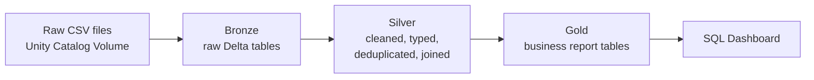

# E-commerce Sales Analytics Pipeline on Databricks (Bronze → Silver → Gold)

An end-to-end data pipeline built on **Databricks Free Edition** that turns raw online-store data (orders, items, payments, reviews, customers, products, sellers) into clean, analysis-ready tables and a sales dashboard.

**Tech stack:** Databricks Free Edition · PySpark · Delta Lake · Unity Catalog · Databricks SQL Dashboard · Databricks Jobs · Git

---

## 1. Business problem

An online store has its data spread across many raw CSV files. This project answers questions the business would ask:

- How does revenue change month by month?
- Which product categories earn the most?
- Which states have the slowest or most late deliveries?
- How many customers come back to buy again?
- Which payment methods do customers use most?

## 2. Architecture



| Layer | Purpose | Notebook |
|-------|---------|----------|
| Bronze | Load raw CSVs as-is into Delta tables, with source file name and ingestion time | `01_bronze` |
| Silver | Cast types, remove duplicates, filter bad rows, join tables, add delivery metrics | `02_silver` |
| Gold | Aggregated tables ready for reporting | `03_gold` |

The three notebooks run in order as a **Databricks Job** (`ecommerce_medallion_pipeline`): `bronze → silver → gold`.

## 3. Data

- **Source:** Brazilian E-Commerce Public Dataset by Olist (Kaggle).
- **Files used:** orders, order items, order payments, order reviews, customers, products, sellers, product category translation.
- The raw data is **not included in this repo**. Please download it from Kaggle and check the dataset's license on its page before reuse.

## 4. Pipeline steps

### Bronze
- Reads each CSV from a Unity Catalog volume with PySpark.
- Keeps every column as a string (no cleaning at this stage).
- Adds `_source_file` and `_ingested_at` columns.
- Saves 8 Delta tables (`bronze_*`).

### Silver
- Converts text columns to proper types using `try_cast`, so bad values become NULL instead of stopping the job.
- Removes duplicate rows using each table's key (for example `order_id`, or `order_id + order_item_id`).
- Filters out rows with missing keys or negative prices and payment values.
- Keeps only the latest review per order using a window function (`row_number`).
- Translates product categories to English with a left join.
- Builds `silver_order_details` by joining items, orders, customers, and products, and adds:
  - `purchase_month`
  - `delivery_days`
  - `is_late` (1 if delivered after the estimated date, otherwise 0)

### Gold
| Table | What it shows |
|-------|---------------|
| `gold_monthly_revenue` | Revenue and number of unique orders per month |
| `gold_top_categories` | Revenue and items sold per product category |
| `gold_delivery_by_state` | Average delivery days and late-delivery % per state |
| `gold_repeat_customers` | One-time vs repeat customers |
| `gold_payment_types` | Number of payments and total value per payment type |

Cancelled and unavailable orders are excluded from revenue reports.

> Note: `silver_order_details` has one row per item, so orders are counted with `countDistinct("order_id")`, while items are counted with `count`.

## 5. Data quality check

| Metric | Value |
|--------|-------|
| Raw orders (Bronze) | `<<RAW_ORDERS>>` |
| Clean orders (Silver) | `<<CLEAN_ORDERS>>` |
| Rows removed | `<<REMOVED_ORDERS>>` |

## 6. Key findings

> Replace the placeholders below with the numbers from your own runs.

- Top 3 categories by revenue: `<<CATEGORY_1>>`, `<<CATEGORY_2>>`, `<<CATEGORY_3>>`
- Repeat customers: `<<REPEAT_COUNT>>` vs one-time customers: `<<ONE_TIME_COUNT>>`
- Most used payment type: `<<PAYMENT_TYPE>>`
- State with the highest late-delivery percentage: `<<STATE>>` (`<<LATE_PERCENT>>`%)

## 7. Screenshots

| Dashboard | Job run |
|-----------|---------|
|  |  |

## 8. How to run it

1. Create a free account on [Databricks Free Edition](https://www.databricks.com/learn/free-edition).
2. Download the Olist dataset from Kaggle and unzip it.
3. In a notebook, create the schema and volume:
   ```sql
   CREATE SCHEMA IF NOT EXISTS workspace.ecommerce;
   CREATE VOLUME IF NOT EXISTS workspace.ecommerce.raw_files;
   ```
4. Upload the CSV files to `/Volumes/workspace/ecommerce/raw_files/`.
5. Import the notebooks from the `notebooks/` folder.
6. Run them in order (`01_bronze`, `02_silver`, `03_gold`), or create a Job with three dependent notebook tasks.
7. Create a dashboard on the `gold_*` tables.

If your catalog is not named `workspace`, change the name in the notebooks.

## 9. Limitations and next steps

- Free Edition uses serverless compute only, so there are no custom clusters, and some features (for example DataFrame caching) are not available.
- The pipeline fully reloads all tables on each run. A next step is incremental loading with Delta `MERGE`.
- Add automated data quality tests and a table that logs rejected rows.
- Add a schedule to the Job and alerts for failures.

## 10. Project structure

```
<<databricks-ecommerce-medallion-pipeline>>/
├── notebooks/
│   ├── 01_bronze.py
│   ├── 02_silver.py
│   └── 03_gold.py
├── screenshots/
└── README.md
```

## Author

**Ravi Prasad Gummalla** · [LinkedIn](https://linkedin.com/in/ravi-prasad-g/) · [GitHub](https://github.com/raviprasadgummalla)
